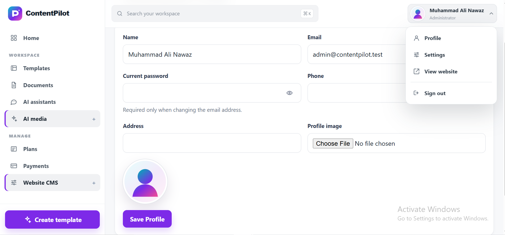

<h1 align="center">🤖 ContentPilot AI</h1>

<p align="center">
  <b>A Laravel 12 AI content SaaS platform with secure admin and client dashboards, guided content templates, private image and audio generation, offline plan payments, invoices, and usage tracking.</b>
</p>

<p align="center">
  
  
  
  
  
  
</p>

<p align="center">
  <b>AI Templates</b> •
  <b>Private Media</b> •
  <b>Admin Dashboard</b> •
  <b>Client Dashboard</b> •
  <b>Plans & Invoices</b>
</p>

---

## 📸 Project Screenshots

> Add sanitized screenshots to `docs/screenshots/` before publishing the final repository presentation.

| Landing Page | Login Page |
|---|---|
|  |  |

| Admin Dashboard | Client Dashboard |
|---|---|
|  |  |

| AI Content Generation | AI Assistants |
|---|---|
|  |  |

| Image Library | Audio Library |
|---|---|
|  |  |

| Plans & Billing | Profile Management |
|---|---|
|  |  |

> Never include API keys, private payment receipts, real customer information, production email addresses, or confidential database data in screenshots.

---

## 🚀 Project Overview

**ContentPilot AI** is a full-stack Laravel SaaS application for generating, reviewing, editing, organizing, and securely storing English-language AI content.

The platform provides separate dashboard experiences for **administrators** and **clients**. Clients can choose guided content templates, generate and edit documents, create private images and audio, track plan usage, submit offline payments, download invoices, and manage their profiles. Administrators can manage plans, templates, content, private media, payments, AI assistants, contacts, and public website content.

This project demonstrates practical Laravel development using secure authentication, email verification, authorization policies, service-layer transactions, atomic AI quotas, private filesystem storage, validated uploads, database notifications, queue workers, scheduled maintenance, relational seed data, responsive Blade interfaces, and automated regression tests.

---

## 🎯 Project Purpose

Creators, freelancers, marketers, and small teams often need more than a basic AI text box. A useful content platform also needs reusable templates, organized document history, media storage, plan limits, billing records, administrative review, and clear security boundaries.

**ContentPilot AI** solves this by providing a structured Laravel workspace where users can:

- Generate editable English content through guided templates
- Organize generated documents and recent activity
- Generate and privately store AI images and audio
- Track word, image, and audio allowances
- Submit offline plan payments for administrator review
- Access billing history and downloadable invoices
- Use configured AI assistants and conversation history
- Manage SaaS data through a secure administrator dashboard

The application is designed as a portfolio-ready Laravel project that demonstrates realistic beginner-to-intermediate full-stack development without unnecessary enterprise complexity.

---

## 🎯 Key Highlights

- 🤖 Laravel-based AI content SaaS platform
- ✍️ Guided template-based content generation
- 📄 Editable generated-document history
- 🖼️ Private AI image generation and media library
- 🎧 Private text-to-speech generation and audio library
- 💬 Configurable AI assistants and conversations
- 👤 Secure client dashboard and profile management
- 🧑‍💼 Administrator dashboard and platform management
- 💳 Offline payment submission and administrator review
- 🧾 Billing history and downloadable PDF invoices
- 📊 Plan-based words, image, and audio usage tracking
- 🔐 Role separation, ownership controls, and secure uploads
- 🗄️ MySQL-backed plans, templates, media, documents, and demo data
- 🧪 Pest feature and unit test coverage
- 📱 Responsive project-owned frontend interface
- ⚙️ Queue worker and scheduler support

---

## ✨ Features

### 👤 Client Features

| Feature | Description |
|---|---|
| Authentication | Register, sign in, sign out, reset passwords, confirm passwords, and verify email addresses |
| Client Dashboard | View database-backed plan usage, recent documents, media, and activity |
| AI Templates | Browse active content templates and provide structured input fields |
| Content Generation | Generate English content through allowlisted AI models and guarded prompts |
| Document Management | View, edit, update, and delete owned generated documents |
| Image Generation | Create AI images and access them through owner-authorized private delivery |
| Audio Generation | Generate text-to-speech audio and access private audio files |
| AI Assistants | Work with configured assistants and stored conversation history |
| Plans & Billing | View plans, submit offline payment proof, and follow payment status |
| Invoices | Download authorized PDF invoices for owned billing records |
| Notifications | Receive database notifications after payment review |
| Profile Management | Update name, contact details, email, password, avatar, and account settings |
| Live Image Preview | Preview a new profile image before saving it |
| Responsive Dashboard | Use desktop and mobile navigation with accessible controls |

---

### 🧑‍💼 Administrator Features

| Feature | Description |
|---|---|
| Admin Dashboard | View platform totals, recent activity, popular templates, users, and billing information |
| Plan Management | Create, update, activate, deactivate, and delete plans and usage limits |
| Template Management | Create templates, define structured fields, configure prompts, and manage supported icons |
| Generated Documents | Review, edit, update, and delete generated content records |
| Payment Review | Review private receipts and approve or reject pending offline payments |
| Plan Activation | Activate an approved plan through a database transaction and reset relevant usage state |
| AI Assistant Management | Create, update, delete, and test assistant configurations |
| Private Media Management | Manage generated image and audio records through authorized routes |
| Contact Management | Review and remove submitted contact messages |
| CMS Management | Manage landing-page slider content, headings, and frequently asked questions |
| Administrator Provisioning | Create verified administrators through a protected Artisan command |
| Profile & Security | Update administrator profile information and password settings |

---

### 🤖 AI Content & Media Features

| Feature | Description |
|---|---|
| English Content Generation | Produces editable English-language content from guided user input |
| Template Prompt Validation | Rejects undeclared placeholders and invalid template configurations |
| Model Allowlists | Restricts content, image, audio, and assistant requests to approved models |
| Voice Allowlists | Restricts text-to-speech requests to approved voices |
| Atomic Quotas | Reserves quota before generation and commits or releases it safely |
| Failure Recovery | Releases reserved allowance when provider or persistence operations fail |
| Rate Limiting | Applies separate limits for content, media, chat, payments, and contact submissions |
| Private Storage | Stores generated media outside the public web root |
| Owner Authorization | Delivers private files only to their owner or an authorized administrator |
| Safe Uploads | Validates MIME type, file signature, size, and image dimensions |

---

### 💳 Plans & Billing Features

| Feature | Description |
|---|---|
| Seeded Plans | Starter, Creator, and Agency plans are stored in MySQL through repeatable seeders |
| Usage Limits | Tracks monthly words plus image and audio generation allowances |
| Offline Checkout | Allows clients to submit payment references and private proof files |
| Pending Review | Keeps the existing plan active while a payment awaits administrator review |
| Approval Workflow | Activates the requested plan only after administrator approval |
| Rejection Workflow | Records rejection without changing the current plan |
| Duplicate Protection | Prevents duplicate pending requests and duplicate payment references |
| Billing History | Displays database-backed payment records and statuses |
| PDF Invoices | Generates downloadable invoices through DOMPDF |

---

## 🧑‍💼 User Roles

| Role | Access Level |
|---|---|
| 👑 Administrator | Platform management, plans, templates, payments, assistants, CMS, contacts, content, and media |
| 👤 Client | Content generation, documents, images, audio, assistants, plans, billing, invoices, and profile management |
| 🌐 Guest | Landing page, features, use cases, pricing, contact form, registration, and authentication |

---

## 🛠 Tech Stack

| Layer | Technologies |
|---|---|
| Backend | Laravel 12, PHP 8.3+ |
| Database | MySQL 8.0+ / compatible MariaDB |
| Frontend | Blade, project-owned CSS, project-owned JavaScript |
| Assets | Local SVG logos, icons, avatars, and deterministic frontend build manifest |
| AI Integration | `openai-php/laravel` |
| Image Processing | Intervention Image |
| PDF Generation | DOMPDF |
| Authentication | Laravel session authentication and email verification |
| Authorization | Middleware, gates, policies, and owner-scoped queries |
| Notifications | Laravel database notifications |
| Queues & Scheduling | Laravel queue worker and scheduler |
| Testing | Pest, PHPUnit, Laravel testing utilities, SQLite in-memory tests |
| Code Style | Laravel Pint |
| Automation | GitHub Actions and Dependabot |
| Package Management | Composer and npm |

---

## 🏗 Architecture Overview

ContentPilot AI follows Laravel MVC architecture with dedicated request validation, authorization boundaries, service-layer business logic, relational models, private storage, queues, and scheduled maintenance.

```text
contentpilot-ai/
├── app/
│   ├── Console/
│   │   └── Commands/
│   ├── Enums/
│   ├── Exceptions/
│   ├── Http/
│   │   ├── Controllers/
│   │   ├── Middleware/
│   │   └── Requests/
│   ├── Models/
│   ├── Notifications/
│   ├── Policies/
│   ├── Providers/
│   └── Services/
│       ├── Ai/
│       ├── Quota/
│       └── Storage/
├── bootstrap/
├── config/
├── database/
│   ├── factories/
│   ├── migrations/
│   └── seeders/
├── public/
│   └── assets/
│       ├── css/
│       ├── images/
│       └── js/
├── resources/
│   ├── css/
│   ├── js/
│   └── views/
├── routes/
│   ├── auth.php
│   ├── console.php
│   └── web.php
├── scripts/
├── storage/
├── tests/
├── .env.example
├── artisan
├── composer.json
├── package.json
└── README.md
```

---

## 🔄 Application Flow

### Client Content Generation Flow

```text
Client Registration / Login
        ↓
Email Verification
        ↓
Open Client Dashboard
        ↓
Choose an Active Template
        ↓
Enter Structured Source Details
        ↓
Reserve Plan Quota Atomically
        ↓
Generate AI Content
        ↓
Save Editable Document in MySQL
        ↓
Commit Usage or Release Reservation on Failure
```

### Administrator Management Flow

```text
Administrator Login
        ↓
Open Admin Dashboard
        ↓
Manage Plans / Templates / Assistants
        ↓
Review Payments and Private Receipts
        ↓
Approve or Reject Requests
        ↓
Manage CMS, Contacts, Documents, and Media
        ↓
Monitor Platform Data
```

### Billing Flow

```text
Client Chooses a Paid Plan
        ↓
Submit Payment Reference and Proof
        ↓
Payment Stored as Pending
        ↓
Administrator Reviews Private Receipt
        ↓
Approve or Reject Inside a Transaction
        ↓
Client Receives Notification
        ↓
Billing History and Invoice Remain Available
```

### Private Media Flow

```text
Authenticated User Submits Prompt or Text
        ↓
Validate Model, Voice, Prompt, and Quota
        ↓
Generate Image or Audio
        ↓
Store File on Private Disk
        ↓
Store Metadata in MySQL
        ↓
Serve File Through an Authorized Controller Route
```

---

## 🗄 Database Overview

The application uses MySQL or MariaDB with Laravel migrations, factories, and repeatable seeders.

### Main Data Areas

| Data Area | Purpose |
|---|---|
| Users | Stores administrators and clients, roles, profile details, plan assignment, and usage counters |
| Plans | Stores prices, word limits, template allowances, image limits, and audio limits |
| Templates | Stores AI prompt templates, categories, icons, and active state |
| Template Input Fields | Stores structured input definitions for each template |
| Generated Content | Stores template inputs, generated outputs, model information, and ownership |
| Generated Images | Stores private image paths, prompts, models, and ownership |
| Generated Audio | Stores private audio paths, source text, voice, model, and ownership |
| AI Usage Reservations | Supports atomic quota reservation and failure recovery |
| Billing History | Stores plans, payment references, proof paths, statuses, and review details |
| Chat Assistants | Stores administrator-configured assistant definitions |
| Chat Conversations | Stores assistant conversations and messages |
| Contacts | Stores public contact-form submissions |
| Sliders / Headings / Questions | Stores landing-page CMS content |
| Notifications | Stores user-facing payment review notifications |

---

## 🔐 Security Implementations

| Security Area | Implementation |
|---|---|
| Authentication | Session authentication, registration, logout, password reset, and password confirmation |
| Email Verification | Protected dashboards require verified email addresses |
| Role Separation | Dedicated administrator and client middleware and route groups |
| Ownership Protection | Owner-scoped queries and policies prevent IDOR access to documents, media, invoices, and notifications |
| CSRF Protection | State-changing forms and routes use Laravel CSRF protection |
| Mutation-Safe Routes | Create, update, delete, logout, and review operations use appropriate HTTP methods |
| Atomic Quotas | Row locking and reservations prevent concurrent over-consumption |
| Upload Security | MIME, signature, size, and image-dimension checks protect uploads |
| Private Files | Receipts, generated images, and audio are stored outside the public web root |
| Image Re-encoding | Accepted profile images are re-encoded to random WebP filenames |
| Rate Limiting | Authentication, AI, media, chat, payment, and contact routes have dedicated limits |
| Logging Protection | Sensitive prompts, payment data, API keys, and credentials are redacted from logs |
| Security Headers | Web responses include defensive browser security headers and CSP nonces |
| Environment Security | Secrets and credentials remain in `.env`, which is excluded from Git |
| Dependency Auditing | Composer, npm, GitHub Actions, and Dependabot check dependency security |

> Before production deployment, enable HTTPS, set `APP_DEBUG=false`, enable secure cookies, use production mail and queue services, protect OpenAI credentials, and review all administrator accounts and permissions.

---

## ⚡ Performance & Code Quality

- Uses Laravel MVC architecture and focused service classes
- Uses Form Requests for reusable validation rules
- Uses database transactions and row locks for billing and quotas
- Uses private storage for generated media and payment receipts
- Uses migrations and repeatable seeders for reliable setup
- Uses queues for background work and database notifications
- Uses the scheduler for quota-reservation cleanup and maintenance
- Uses project-owned frontend assets without a commercial dashboard bundle
- Uses a deterministic frontend build and manifest verification process
- Uses Laravel Pint for consistent PHP formatting
- Uses Pest feature and unit tests for regression protection
- Uses Composer and npm security audits in local and CI workflows

---

## 📡 Routes / System Areas

| Area | Purpose |
|---|---|
| `/` | Public landing page |
| `/features` | Platform feature overview |
| `/use-cases` | Realistic application use cases |
| `/pricing` | Database-backed active plan listing |
| `/contact` | Public contact form |
| `/login` | User and administrator login |
| `/register` | Client registration |
| `/user/dashboard` | Client dashboard |
| `/user/templates` | Active template library |
| `/user/documents` | Owned generated-document history |
| `/user/images` | Private generated-image library |
| `/user/audio` | Private generated-audio library |
| `/user/checkout` | Plan selection, billing history, and offline payment submission |
| `/user/profile` | Client profile management |
| `/admin/dashboard` | Administrator dashboard |
| `/admin/plans` | Plan management |
| `/admin/templates` | Template and prompt-field management |
| `/admin/payments` | Payment review and private receipt access |
| `/admin/assistants` | AI assistant management and conversations |
| `/admin/documents` | Generated-document management |
| `/admin/images` | Generated-image management |
| `/admin/audio` | Generated-audio management |
| `/admin/cms/*` | Landing-page CMS management |

> Route parameters, middleware, and exact names can be inspected with `php artisan route:list --except-vendor`.

---

## ⚙️ Installation Guide

### Requirements

- PHP 8.3 or higher
- Composer 2
- Node.js 20 or higher and npm
- MySQL 8.0+ or compatible MariaDB
- Git
- PHP extensions: BCMath, Ctype, cURL, DOM/XML, Fileinfo, Filter, GD, JSON, Mbstring, OpenSSL, PDO MySQL, Session, Tokenizer, and Zip
- OpenAI API key when live AI generation is enabled

---

### 1️⃣ Clone the Repository

```bash
git clone https://github.com/CodeByMan/contentpilot-ai.git
cd contentpilot-ai
```

---

### 2️⃣ Install PHP Dependencies

```bash
composer install
```

Do not use `composer update` during normal installation. The committed `composer.lock` provides the reviewed dependency versions.

---

### 3️⃣ Install Frontend Dependencies

```bash
npm ci
```

---

### 4️⃣ Create Environment File

For Windows PowerShell:

```powershell
Copy-Item .env.example .env
```

For Windows Command Prompt:

```cmd
copy .env.example .env
```

For macOS/Linux:

```bash
cp .env.example .env
```

---

### 5️⃣ Generate Application Key

```bash
php artisan key:generate
```

---

### 6️⃣ Configure Database

Create a MySQL or MariaDB database:

```sql
CREATE DATABASE contentpilot_ai
  CHARACTER SET utf8mb4
  COLLATE utf8mb4_unicode_ci;
```

Update `.env`:

```env
APP_NAME="ContentPilot AI"
APP_ENV=local
APP_DEBUG=false
APP_URL=http://127.0.0.1:8000

DB_CONNECTION=mysql
DB_HOST=127.0.0.1
DB_PORT=3306
DB_DATABASE=contentpilot_ai
DB_USERNAME=contentpilot
DB_PASSWORD=
```

Use the database username and password configured for your local MySQL or MariaDB installation.

---

### 7️⃣ Configure OpenAI

Add a server-side API key and keep all selected models and voices inside the configured allowlists:

```env
OPENAI_API_KEY=
OPENAI_REQUEST_TIMEOUT=30

AI_CONTENT_MODELS=gpt-4o-mini
AI_DEFAULT_CONTENT_MODEL=gpt-4o-mini

AI_IMAGE_MODELS=gpt-image-2
AI_IMAGE_MODEL=gpt-image-2

AI_AUDIO_MODELS=tts-1,tts-1-hd
AI_AUDIO_MODEL=tts-1
AI_AUDIO_VOICES=nova
AI_AUDIO_VOICE=nova
```

Live provider calls may incur cost. The application and normal automated tests can be installed without enabling a live OpenAI test.

---

### 8️⃣ Run Migrations and Seeders

```bash
php artisan migrate --seed
```

The seeders create database-backed plans, public CMS content, users, templates, template fields, generated documents, private demo images and audio, payments, assistants, conversations, contacts, and dashboard statistics.

Demo content is skipped automatically when `APP_ENV=production`.

For a disposable local database only:

```bash
php artisan migrate:fresh --seed
```

> `migrate:fresh` permanently removes all existing database tables and data. Never run it against a database containing information you need.

---

### 9️⃣ Create an Administrator

```bash
php artisan contentpilot:admin:create --name="Administrator Name" --email="admin@example.com"
```

The command prompts privately for a strong password and creates a verified administrator without storing a predictable password in source code.

---

### 🔟 Link Storage

```bash
php artisan storage:link
```

Generated AI media and payment receipts remain private and are not served through the public storage link.

---

### 1️⃣1️⃣ Build Frontend Assets

```bash
npm run build
npm run check:frontend
npm run check:licenses
```

---

### 1️⃣2️⃣ Start Laravel Server

```bash
php artisan serve
```

Open:

```text
http://127.0.0.1:8000
```

---

### 1️⃣3️⃣ Start Queue Worker

Open another terminal:

```bash
php artisan queue:work --tries=3 --timeout=120
```

---

### 1️⃣4️⃣ Start Scheduler

For local development:

```bash
php artisan schedule:work
```

In production, configure the hosting scheduler or cron service to run `php artisan schedule:run` every minute.

---

## 🏗 Build for Production

Compile and verify frontend assets:

```bash
npm ci
npm run build
npm run check:frontend
npm run check:licenses
npm audit --omit=dev --audit-level=high
```

Install production PHP dependencies:

```bash
composer install --no-dev --classmap-authoritative --no-interaction
```

Recommended production settings:

```env
APP_ENV=production
APP_DEBUG=false
SESSION_SECURE_COOKIE=true
```

Prepare Laravel caches after configuring the production environment:

```bash
php artisan migrate --force
php artisan optimize
```

The production web root must point to the `public/` directory. Run a persistent queue worker and invoke the scheduler every minute.

---

## 🔑 Demo Login Credentials

ContentPilot AI intentionally does **not** publish fixed passwords for seeded demo accounts.

The relational demo seeder creates the following client records with securely randomized passwords:

| Role | Name | Email | Plan |
|---|---|---|---|
| 👤 Client | Ayesha Khan | `ayesha.creator@contentpilot.demo` | Creator |
| 👤 Client | Hamza Ali | `hamza.marketing@contentpilot.demo` | Agency |
| 👤 Client | Sara Malik | `sara.studio@contentpilot.demo` | Starter |

To test the application interactively:

1. Register a new client through `/register`, or
2. Create an administrator with the protected Artisan command shown above.

> Demo records are for local development and portfolio testing only. Never publish real production credentials, password hashes, API keys, payment references, private receipts, or `.env` secrets.

---

## 📁 Important Folder Structure

```text
app/Services/Ai/
├── AiContentGenerator.php
├── AiMediaGenerator.php
└── AssistantChatService.php

app/Services/Quota/
└── AiQuotaService.php

app/Services/Storage/
└── SecureUploadService.php

database/seeders/
├── ApplicationReferenceSeeder.php
├── DatabaseSeeder.php
└── DemoContentSeeder.php

resources/
├── css/contentpilot.css
├── js/contentpilot.js
└── views/

public/assets/
├── css/contentpilot.css
├── images/
├── js/contentpilot.js
└── contentpilot-build-manifest.json

routes/
├── auth.php
├── console.php
└── web.php

tests/
├── Feature/
└── Unit/
```

---

## 🧪 Testing Checklist

- [ ] Install Composer dependencies
- [ ] Install npm dependencies
- [ ] Create `.env`
- [ ] Generate the Laravel application key
- [ ] Configure the MySQL or MariaDB connection
- [ ] Run migrations and seeders
- [ ] Create an administrator account
- [ ] Create the storage link
- [ ] Build and verify frontend assets
- [ ] Run Laravel Pint
- [ ] Run the complete test suite
- [ ] Run Composer security audit
- [ ] Run npm security audit
- [ ] Start the application server
- [ ] Start the queue worker
- [ ] Start the scheduler
- [ ] Test registration and email-verification flow
- [ ] Test administrator and client dashboards
- [ ] Test template-based content generation
- [ ] Test document edit and delete actions
- [ ] Test image generation and private file access
- [ ] Test audio generation and private file access
- [ ] Test offline payment submission
- [ ] Test administrator payment approval and rejection
- [ ] Test invoice download authorization
- [ ] Test profile image preview and update
- [ ] Test responsive navigation on mobile widths

Run the complete quality gate:

```bash
vendor/bin/pint --test
php artisan test
composer ci
composer audit
npm run check:frontend
npm run check:licenses
npm audit --omit=dev --audit-level=high
```

Expected verified baseline:

```text
Laravel Pint: 152 files passed
Tests: 1 skipped, 73 passed (313 assertions)
Composer audit: no security vulnerability advisories
npm audit: 0 vulnerabilities
```

The skipped test is the optional live OpenAI provider test unless it is explicitly enabled with controlled credentials.

---

## ✅ Recruiter Highlights

This project demonstrates practical full-stack Laravel development skills, including:

- ✅ Laravel 12 MVC architecture
- ✅ Separate administrator and client workflows
- ✅ Authentication and email verification
- ✅ Middleware, gates, policies, and ownership authorization
- ✅ Guided AI content templates and prompt validation
- ✅ OpenAI content, image, audio, and assistant integration structure
- ✅ Atomic usage quota reservations and failure recovery
- ✅ Private generated-media storage and authorized delivery
- ✅ Secure image and payment-proof uploads
- ✅ Offline payment review and plan activation workflow
- ✅ PDF invoice generation
- ✅ MySQL migrations, relationships, and repeatable seeders
- ✅ Database-backed dashboard data and realistic demo records
- ✅ Queues, notifications, and scheduled maintenance
- ✅ Responsive Blade frontend with project-owned assets
- ✅ Pest unit and feature tests
- ✅ Laravel Pint, Composer audit, npm audit, and CI automation
- ✅ Professional GitHub documentation and MIT licensing

---

## 🚀 Future Improvements

- 💳 Add Stripe, Paddle, or another verified online payment gateway
- 📈 Add richer administrator usage and revenue analytics
- 📁 Add folders and tags for generated documents
- 📤 Add document export to PDF, DOCX, or Markdown
- 🔎 Add advanced document and media search filters
- 👥 Add team workspaces and member invitations
- 🔐 Add configurable roles and granular permissions
- 🌐 Add a versioned REST API for external clients
- 🔔 Add real-time browser notifications
- 📊 Add provider-cost and token-usage reporting
- 🧠 Add more specialized assistant workflows
- 🐳 Add an optional Docker development environment
- 📱 Add progressive web application support
- 🌍 Add multilingual generation and interface localization

---

## 🔒 Security Notes

Before pushing this project to GitHub, confirm that these files and folders are not committed:

```text
.env
/vendor
/node_modules
/public/storage
/storage/logs/*
/storage/framework/cache/data/*
/storage/framework/sessions/*
/storage/framework/views/*
/storage/app/private/*
/storage/app/public/*
/database/*.sqlite
*.sql
*.zip
```

The `.env` file may contain database passwords, API keys, mail credentials, and application secrets. Commit `.env.example` with placeholders only.

Recommended production settings:

```env
APP_ENV=production
APP_DEBUG=false
SESSION_SECURE_COOKIE=true
```

Report security concerns privately through GitHub private vulnerability reporting when enabled. Do not publish sensitive vulnerability details in a public issue.

---

## 📦 Third-Party Asset Notice

ContentPilot AI distributes project-owned PHP, Blade, CSS, JavaScript, SVG branding, and icon assets under the repository license.

- No commercial theme bundle is included.
- The public stylesheet is `public/assets/css/contentpilot.css`.
- The public JavaScript entry point is `public/assets/js/contentpilot.js`.
- Isotope is not included.
- Softnio, NioBoard, Nioicon, and removed theme distributions are not included.
- Composer and npm dependencies remain subject to their respective maintainers' licenses.

---

## 📌 Repository Information

Recommended repository name:

```text
contentpilot-ai
```

Suggested repository URL:

```text
https://github.com/CodeByMan/contentpilot-ai
```

Suggested repository description:

```text
ContentPilot AI is a secure Laravel 12 SaaS platform for guided AI content, private image and audio generation, assistants, offline plan payments, invoices, and usage tracking.
```

Suggested topics:

```text
laravel php mysql mariadb openai ai-content saas blade pest phpunit content-generation image-generation text-to-speech billing invoices secure-uploads portfolio
```

---

## 👨‍💻 Author

**Muhammad Ali Nawaz**  
Full-Stack PHP / Laravel Developer  
Karachi, Pakistan

- GitHub: [CodeByMan](https://github.com/CodeByMan)
- LinkedIn: `https://www.linkedin.com/in/<your-linkedin-handle>`
- Email: `<your-professional-email>`

Built as a portfolio project to demonstrate practical Laravel SaaS development, secure AI integrations, role-based dashboards, private file handling, offline billing, relational database design, testing, and professional repository preparation.

---

## 📄 License

This project is open-sourced software licensed under the [MIT License](LICENSE).

---

<p align="center">
  <b>⭐ If you like this project, consider starring the repository!</b>
</p>
